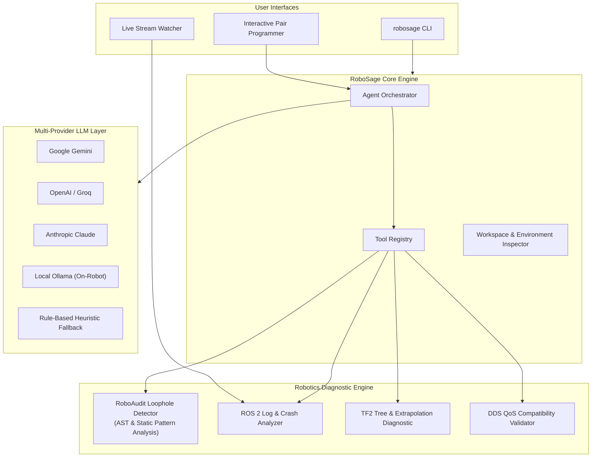

# 🤖 RoboSage: AI Robotics Assistant & Safety Auditor

> An intelligent, multi-provider AI copilot designed specifically for robotics engineers working with **ROS 2 (Humble, Iron, Jazzy)**, autonomous mobile robots (AMRs), manipulators, and simulation environments.

RoboSage automates robotics workflows, triages runtime crashes, intercepts broken DDS communication, and statically fuzzes source code to uncover hidden physical hazards and concurrency deadlocks.

---

## ⚡ Core Capabilities

1. **Safety Loophole & Vulnerability Fuzzer (`robosage audit`)**
   - **Missing E-Stop / Zero-Velocity on Shutdown:** Catches nodes publishing `/cmd_vel` without shutdown handlers (prevents runaway robots).
   - **SingleThreadedExecutor Service Deadlocks:** Catches synchronous `.call()` or `.result()` calls inside callbacks that lock the executor.
   - **Sensor Dropout Watchdogs:** Flags actuators running on unverified or frozen sensor streams without timeout fallback.
   - **Unprotected TF2 Lookups:** Detects `lookup_transform` missing `try...except (TransformException)`.
   - **Unchecked NaN/Inf Propagation:** Catches LaserScan/IMU arrays missing `math.isnan()` or `math.isfinite()` filters that blow up controllers.
   - **MultiThreaded State Mutation:** Detects `MultiThreadedExecutor` and `ReentrantCallbackGroup` usage without `threading.Lock` / `std::mutex`.

2. **Log & Crash Triage Engine (`robosage triage`)**
   - Parses ROS 2 console logs, `/rosout`, RMW DDS warnings, and C++ backtraces.
   - Diagnoses TF2 extrapolation into future/past, frame jumps, and missing intermediate joints.
   - Diagnoses DDS Request vs. Offered (RxO) Quality of Service (QoS) mismatches.
   - Generates instant, drop-in code fixes.

3. **Live Stream Monitor (`robosage watch`)**
   - Tails `~/.ros/log/latest/launch.log` or monitors piped streams in real-time (`ros2 launch ... | robosage watch`).
   - Surfaces instant alerts with root cause analysis when warnings or errors spike.

4. **Multi-Provider AI Intelligence (`robosage chat`)**
   - Works with **Google Gemini**, **OpenAI**, **Claude**, and **Local Ollama** (for air-gapped, on-robot compute).
   - Includes a **Zero-Network Heuristic Fallback Engine** so it functions 100% offline without any API keys.

5. **Safe Robotics Boilerplate Generator (`robosage generate`)**
   - Scaffolds hardened, production-ready differential drive controllers, TF listeners, and thread-safe reentrant nodes.

---

## 🏛 Architecture



---

## 🚀 Quick Start: Running the Application

### 1. Launch the Desktop Web Dashboard (Zero Installation Required)
RoboSage includes a built-in, zero-dependency local web dashboard that automatically opens in your default browser:

```bash
# Start the full visual application:
python3 run.py
# Or using the 1-click executable:
./robosage-app
```

This launches the server at `http://127.0.0.1:8765/` and provides:
- 💬 **Interactive AI Copilot**: Pair programming chat with quick diagnostic prompts.
- 🛡️ **RoboAudit Workspace**: Paste or select code with 1-click example loader and colored hazard badges.
- 📋 **Log & Crash Triage**: Paste `rosout` or terminal crash logs and get immediate actionable fixes.
- 📡 **DDS QoS Matrix**: Interactive compatibility simulator for Publisher vs Subscriber policies.
- ⚡ **Node Scaffolder**: Visual generator with parameter customization, live preview, and 1-click disk save.
- 🩺 **System Doctor**: Real-time inspection of your local ROS 2 installation and environment.

Options:
```bash
python3 run.py --port 9000      # Use custom port
python3 run.py --no-browser     # Run headless/server mode on robot without opening browser
python3 run.py --cli            # Launch terminal TUI directly
```

### 2. Command Line Interface (CLI)
You can also invoke any diagnostic command directly from your terminal:

#### 🩺 Run Environment Health Check
```bash
python3 -m robosage.cli doctor
```

#### 🔍 Audit a ROS 2 Package or Node for Loopholes
```bash
python3 -m robosage.cli audit path/to/my_node.py
# Or audit an entire src directory:
python3 -m robosage.cli audit ~/my_robot_ws/src
```

#### 📋 Triage Crashes and Log Files
```bash
python3 -m robosage.cli triage examples/sample_ros2_crash.log
```

#### ⏱ Live Watcher during Robot Execution
```bash
# Pipe directly from ros2 launch
ros2 launch my_robot bringup.launch.py | python3 -m robosage.cli watch

# Or tail the active ~/.ros/log file
python3 -m robosage.cli watch
```

#### ⚡ Check DDS QoS Compatibility
```bash
# Check if publisher (best_effort, volatile) connects with subscriber (reliable, volatile)
python3 -m robosage.cli check-qos best_effort volatile reliable volatile
```

#### 🛠 Generate Production-Grade Safe Node Templates
```bash
python3 -m robosage.cli generate diff_drive --name my_drive_controller --output my_controller.py
```

#### 💬 Interactive AI Pair Programming
```bash
# Using Gemini
export GEMINI_API_KEY="your_api_key"
python3 -m robosage.cli chat --provider gemini

# Using local Ollama on your robot
python3 -m robosage.cli chat --provider ollama --model llama3

# Or without any API key (runs built-in offline robotics reasoning engine)
python3 -m robosage.cli chat
```

---

## 🧪 Testing

Run the test suite:
```bash
python3 -m unittest discover tests
```

---

## 🛡️ License
Apache-2.0
